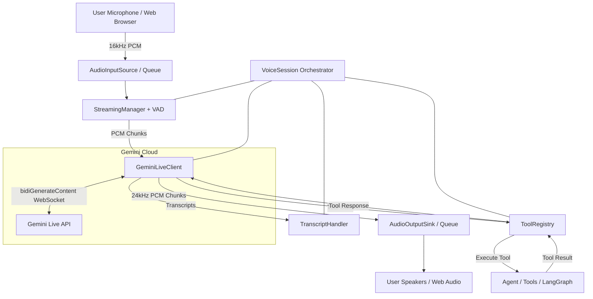

# Gemini Voice AI Module 🎙️

A **modular, reusable, plug-and-play Voice AI module** powered by the Gemini Live API (`google-genai`). It provides real-time bidirectional voice interaction capabilities to **any AI Agent or application** without coupling it to a specific framework, project, or agent architecture.

---

## 🌟 Key Highlights

- **Framework Agnostic**: Zero hard coupling to LangChain, LangGraph, Django, or FastAPI.
- **Gemini Live Bidirectional Streaming**: Native low-latency audio understanding and natural speech synthesis (`gemini-2.5-flash-native-audio-latest`, `gemini-3.8-live`).
- **Live Transcripts**: Real-time user speech transcription and assistant speech transcription.
- **Voice Activity Detection (VAD)**: Adaptive client-side speech onset/offset detection and silence timeouts.
- **Barge-in Interruption**: Instant cancellation of assistant speech when the user starts speaking.
- **Full Interactive Controls**: `interrupt()`, `mute()`, `unmute()`, `pause()`, `resume()`, and `stop()`.
- **Zero-Friction Tool Calling**: Automatically inspects standard Python functions, dataclasses, or LangChain tools and dispatches real-time function calls during speech.
- **Pluggable Audio I/O**:
  - `WebSocketVoiceServer` / `AsyncQueueAudioSource`: Web/mobile clients.
  - `LocalMicrophoneSource` / `LocalSpeakerSink`: Local hardware mic and speakers.
  - `FileAudioSource` / `FileAudioSink`: WAV/PCM file playback and recording.
  - `SimulatedAudioSource`: Headless synthetic signal generation.
- **Security First**: Gemini API keys stay 100% server-side and are never exposed to frontends.

---

## 📐 Architecture Overview



---

## 📦 Installation

```bash
pip install -e .
```

### Optional Dependencies
```bash
# For local hardware audio (sounddevice / portaudio)
pip install sounddevice numpy

# For LangGraph integration
pip install langgraph langchain-core
```

---

## ⚡ Quick Start: 5-Line Integration

Connect Gemini Live Voice to any Python function or agent in seconds:

```python
import asyncio
from gemini_voice import VoiceSession, VoiceConfig, AsyncQueueAudioSource, AsyncQueueAudioSink

async def main():
    session = VoiceSession(
        config=VoiceConfig(voice_name="Puck"),
        input_source=AsyncQueueAudioSource(),
        output_sink=AsyncQueueAudioSink(),
        system_instruction="You are a helpful and concise voice assistant."
    )

    # Register any Python function as a tool
    @session.register_tool
    def get_weather(location: str) -> str:
        """Get the current weather forecast for a city."""
        return f"The weather in {location} is 22°C and sunny."

    # Start the live bidirectional voice session
    await session.start()

    # Send a query (or stream microphone audio chunks)
    await session.send_text("What is the weather in London right now?")
    await asyncio.sleep(5)
    await session.stop()

asyncio.run(main())
```

---

## 🧩 Framework Adapters

### 1. Basic Python Agent (`SimpleAgentAdapter`)

```python
from gemini_voice import VoiceSession, SimpleAgentAdapter

def lookup_database(user_id: str) -> dict:
    """Lookup user account status."""
    return {"user_id": user_id, "tier": "Enterprise", "credits": 450}

adapter = SimpleAgentAdapter(
    tools=[lookup_database],
    system_prompt="You are an enterprise support voice bot."
)

session = VoiceSession()
adapter.attach(session)
await session.start()
```

### 2. LangGraph Integration (`LangGraphAdapter`)

```python
from gemini_voice import VoiceSession, LangGraphAdapter
from my_langgraph_app import compiled_graph

adapter = LangGraphAdapter(
    graph=compiled_graph,
    delegate_to_graph=True,
    input_key="messages"
)

session = VoiceSession()
adapter.attach(session)
await session.start()
```

### 3. Web & Mobile Integration (`WebSocketVoiceServer`)

Run a turnkey WebSocket server that streams audio between browser clients and Gemini Live:

```python
from gemini_voice import WebSocketVoiceServer, VoiceConfig

server = WebSocketVoiceServer(
    host="0.0.0.0",
    port=8765,
    config=VoiceConfig(voice_name="Aoede"),
    tools=[my_custom_tool]
)
await server.serve_forever()
```

---

## 🕹️ Interactive Controls & Event System

Subscribe to events with synchronous or asynchronous handlers:

```python
@session.on("state_change")
def on_state(evt):
    print(f"State: {evt.old_state.value} -> {evt.new_state.value}")

@session.on("transcript")
def on_transcript(evt):
    print(f"[{evt.role.upper()}]: {evt.text} (final={evt.is_final})")

@session.on("tool_call")
def on_tool(evt):
    print(f"Tool executed: {evt.name}({evt.args})")

@session.on("interrupted")
def on_interrupted(evt):
    print("User interrupted the model speech!")
```

### Real-Time Controls

- `await session.interrupt()`: Instantly cancel model audio playback (barge-in).
- `session.mute()` / `session.unmute()`: Mute/unmute microphone while maintaining timing.
- `session.pause()` / `session.resume()`: Pause/resume audio input processing.
- `await session.send_text("Hello")`: Send explicit text into the live session.
- `await session.send_audio(pcm_bytes)`: Push raw 16kHz PCM audio chunk.

---

## 🌐 Running the Web Demo

An interactive browser interface is included with a real-time waveform visualizer, live speech transcripts, barge-in button, and tool execution feed:

```bash
python examples/web_demo/server.py 8080
```
Then open [http://localhost:8080](http://localhost:8080) in your browser.

---

## 🧪 Running Tests

The test suite covers configuration, audio processing, VAD, tool calling, session lifecycles, adapters, and end-to-end live streaming:

```bash
PYTHONPATH=.:./pkgs pytest tests/
```
